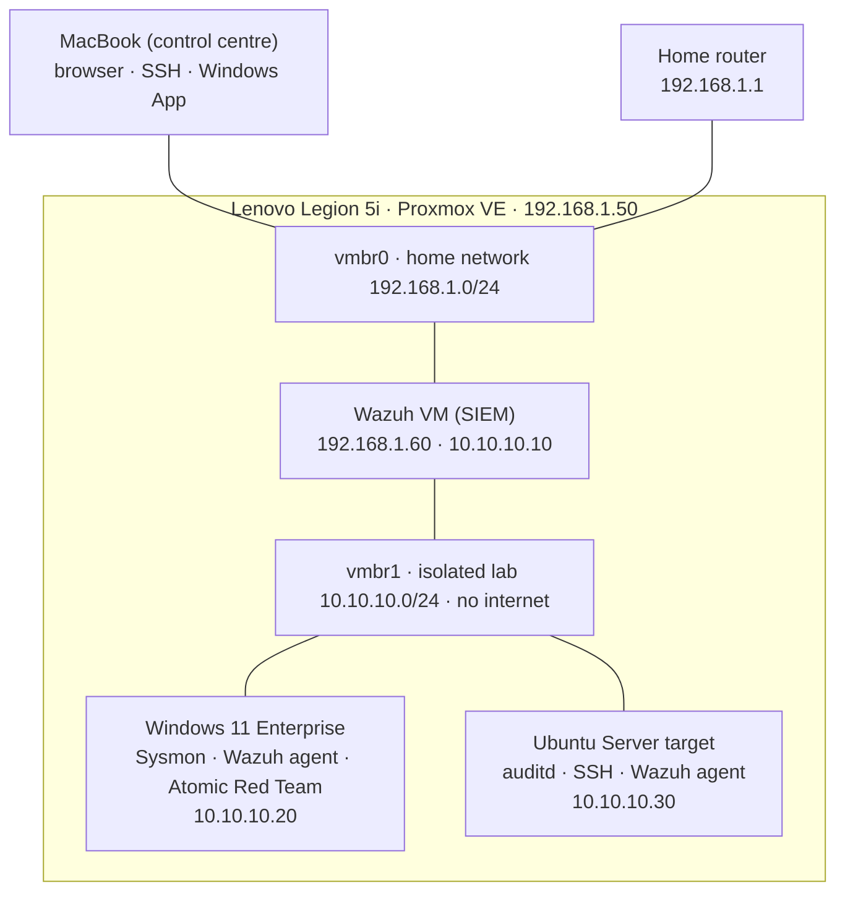

# Home SOC Lab

A self-built Security Operations Centre lab for practising blue-team work: collecting endpoint telemetry, simulating attacker techniques, writing detections mapped to MITRE ATT&CK, and tuning out false positives.

Everything runs on one dedicated laptop (Lenovo Legion 5i, 16GB RAM) using Proxmox VE, and is managed from a MacBook.

## Status

| Phase | What | Status |
| --- | --- | --- |
| 0 | Prep: backup, downloads, BIOS | Done |
| 1 | Proxmox VE install on bare metal | Done |
| 2 | Isolated lab network (`vmbr1`) | Done |
| 3 | Wazuh SIEM (all-in-one) | Not started |
| 4 | Windows 11 victim (Sysmon + agent) | Not started |
| 5 | Ubuntu target (auditd + agent) | Not started |
| 6 | MacBook as control centre | Not started |
| 7 | Attack, detect, tune (Atomic Red Team) | Not started |
| 8 | Write-ups | Ongoing |

Checklist: [docs/plan.md](docs/plan.md) · Step-by-step build: [docs/runbook.md](docs/runbook.md) · Progress log: [docs/build-log.md](docs/build-log.md)

## Architecture



Attacks run only on the isolated `vmbr1` bridge. Wazuh sits on both networks, so lab agents report to it and the MacBook reaches its dashboard. Details: [docs/architecture.md](docs/architecture.md)

## Stack

- **Hypervisor:** Proxmox VE
- **SIEM:** Wazuh (manager, indexer, dashboard)
- **Endpoint telemetry:** Sysmon (sysmon-modular config), PowerShell Script Block Logging, Windows advanced audit policy, auditd
- **Adversary simulation:** Atomic Red Team (Invoke-AtomicRedTeam)
- **Framework:** MITRE ATT&CK

## Repo layout

```
docs/          plan, architecture, design decisions, build log
detections/    one write-up per ATT&CK technique
rules/         custom Wazuh rules (local_rules.xml)
configs/       config snippets for each machine
screenshots/   evidence referenced from write-ups
```

## Detections

See [detections/README.md](detections/README.md) for the index.
